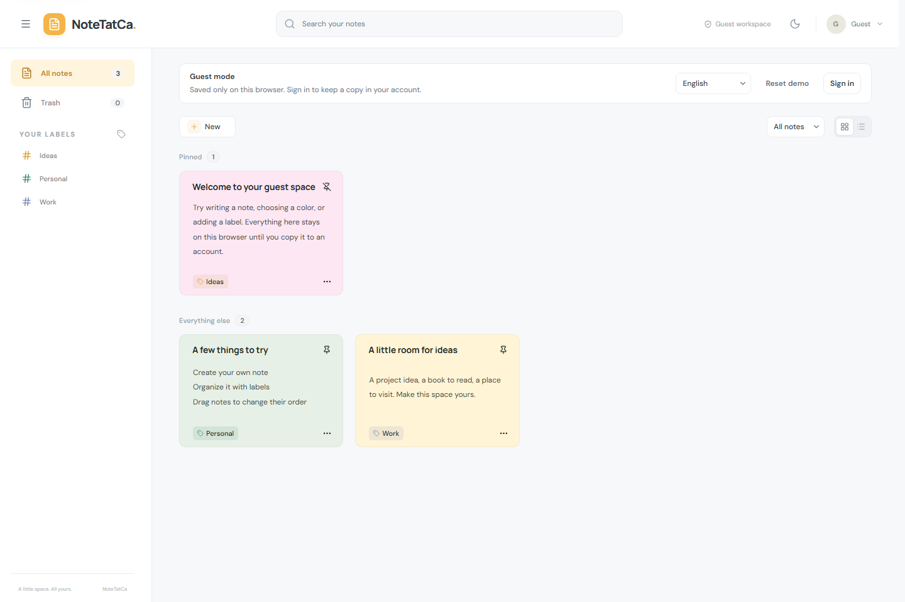
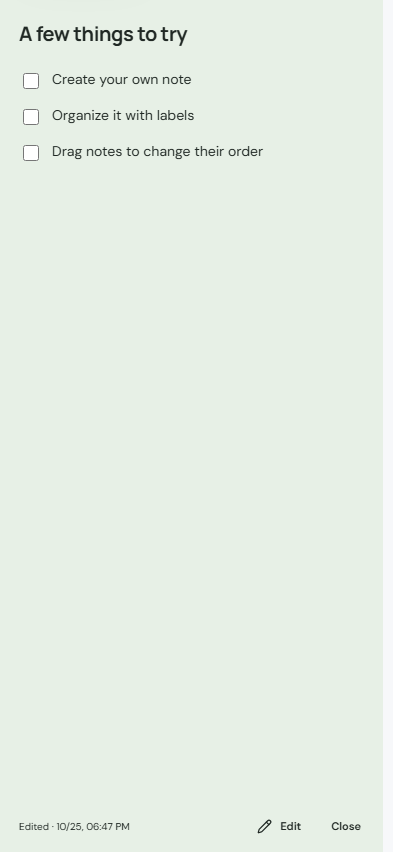

# NoteTatCa

A personal space to capture ideas, build checklists, and organize everyday work — with rich-text editing, autosave, and offline support.

**[Try Guest Mode](https://note-tat-ca.vercel.app/guest)** · [Project Docs](docs/00-README.md) · [Roadmap](docs/ROADMAP-CONTENT-COLLABORATION.md)

**In active development.** Try the app without signing up. Guest notes stay in your browser, with an option to copy them into your account after signing in. The live Guest demo was opened and checked with three sample notes on **October 25, 2026**.

## Screenshots

Captured locally in Guest mode using sample data on October 25, 2026, at source commit `35217eb`.





## Current Features

- **Write and organize:** rich text, checklists, Markdown shortcuts, text and background colors, and emoji; search, labels, pinning, and drag-and-drop ordering.
- **Autosave and offline work:** IndexedDB stores data on the device. Signed-in users can view, create, and edit downloaded notes offline, sync when reconnected, and resolve version conflicts.
- **Guest mode and recovery:** explore sample notes without an account, optionally copy Guest notes into an account, and restore trashed notes within 30 days.
- **Accounts and privacy:** email/Google sign-in and session management. Notes are private to each user; administrators manage accounts and statistics without access to other users' note content.
- **Everyday tools:** recurring reminders with time-zone support, in-app/email notifications for accounts, a responsive layout, light/dark themes, and English, Vietnamese, Chinese, and Japanese interfaces.

Offline access covers data already downloaded to the device. Clearing browser storage can remove unsynced changes. Guest mode excludes reminders, email, and administration. Email reminders require configured delivery services and background jobs; Guest screenshots demonstrate the notes interface only.

## Planned Features

- Note templates, heading-based tables of contents, and links between notes.
- Images and file attachments, filtering by file type, tables, audio/video, and drawing with pen or touch.
- Invitations to view notes and leave comments, with permissions controlled by the note owner.

These features are **not implemented yet**, with no committed release dates. Version history and full export/import remain proposals; real-time collaborative editing requires a separate decision. See the [detailed roadmap](docs/ROADMAP-CONTENT-COLLABORATION.md).

## Stack and Architecture

**React + TypeScript + Vite + Tiptap → ASP.NET Core 8 API + Identity → EF Core → PostgreSQL / SQL Server.** IndexedDB stores Guest data and the offline sync queue.

The frontend lives in `ntc_react/`, the backend in `ntc_aspnet/`, and maintained documentation in `docs/`. The API enforces resource ownership. Autosave uses versions to detect conflicts and idempotency keys to prevent duplicate creates on retry. Read the [architecture overview](ARCHITECTURE.md) and [frontend implementation notes](docs/FRONTEND-IMPLEMENTATION.md).

## Quick Start

Requires **Node.js 24**. Run from the repository root:

```powershell
npm --prefix ntc_react ci
npm --prefix ntc_react run dev
```

Open [Guest mode locally](http://127.0.0.1:5173/guest); no API or database is required. Account features also require the **.NET 8 SDK** and a separately prepared PostgreSQL or SQL Server database:

```powershell
# In a separate terminal, after configuring the database and secrets:
dotnet run --project ntc_aspnet/NTC.API --launch-profile https
```

React proxies API requests to HTTP port `5032` by default. See the [local setup guide](docs/10-setup-local.md), [configuration standard](docs/CONFIGURATION-STANDARD.md), [backend environment example](.env.example), and [frontend environment example](ntc_react/.env.example). ASP.NET does not load `.env` automatically. Keep secrets outside Git; API startup does not migrate or seed the database.

## Validation

Run from the repository root:

```powershell
npm --prefix ntc_react test
npm --prefix ntc_react run build
dotnet build ntc_aspnet/NTC.sln -c Release -warnaserror
dotnet test ntc_aspnet/NTC.Tests/NTC.Tests.csproj -c Release --no-build
```

Browser tests use an isolated API fixture, SQLite, and captured email. See the [frontend test runbook](ntc_react/README.md#verify-using-synthetic-data).

Checked on **October 25, 2026**, at source commit `35217eb`: 104 Vitest tests, 4 configuration checks, and 24 focused HTTP regression tests passed; React production and .NET Release builds passed. Local and live Guest smoke checks passed. The full E2E and backend suites were not rerun for this documentation update. See the [worklog](docs/worklog.md) for evidence and limits; these results do not guarantee later revisions. Continue with the [documentation index](docs/00-README.md).
